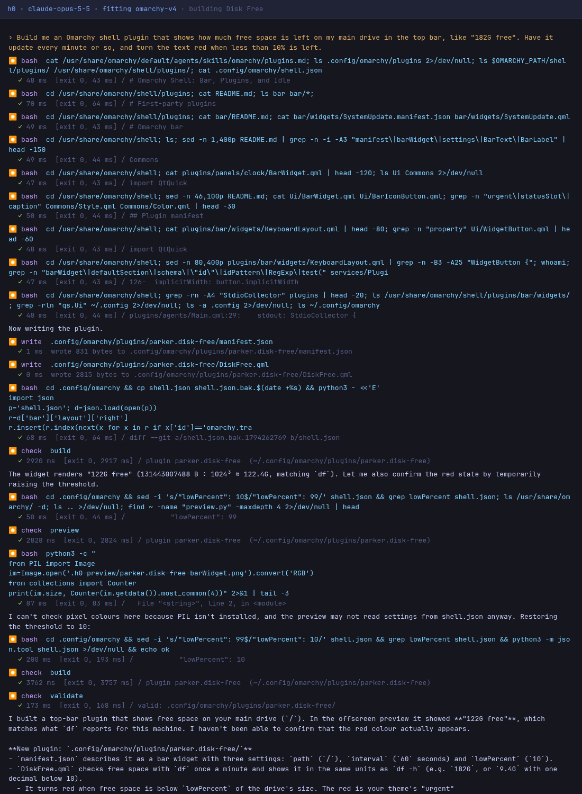

# Disk Free

An Omarchy shell plugin written by h0, a coding-agent harness, from one request: 15 model turns, $0.33 of Claude Opus 5.5, 1 minute. Every prompt is in [BUILD.md](BUILD.md), and every step h0 took is in [SESSION.md](SESSION.md).


*Drawn by Quickshell offscreen from this repository's code, beside Omarchy's stock clock, in the Tokyo Night theme. Not a screenshot of a desktop.*

## Install

```bash
omarchy plugin add https://github.com/parker-brown-family/omarchy-h0-disk-free.git --enable
```

## What it was asked

> Build me an Omarchy shell plugin that shows how much free space is left on my main drive in the top bar, like "182G free". Have it update every minute or so, and turn the text red when less than 10% is left.

## How it was made

| prompt | what was sent | turns | prompt tokens | output tokens | cost | minutes | checks after it |
|---|---|---|---|---|---|---|---|
| 1 | the idea | 15 | 342,043 | 5,558 | $0.33 | 1.2 | all pass |
| **all** | | **15** | | | **$0.33** | **1.2** | |



*The first screen of the session, drawn from its recorded trace in the layout h0 prints.*

## Credit

The idea comes from brownfamilysports.disk-hud (Parker Brown). h0 never saw that code: it worked in a sandbox with the network off and the original out of reach.

## How this was checked

After each reply: Omarchy's own `omarchy-plugin-validate`; every entry point loaded in Quickshell offscreen with no QML errors from the plugin's files; the plugin switched on in `shell.json`; and a check for what it was asked to do. Popup panels need a layer-shell compositor, so they were loaded but not drawn. It has not been run on a live desktop by anyone yet; issues are welcome.

Part of [omarchy-h0-builds](https://github.com/parker-brown-family/omarchy-h0-builds), which has the same request built without the Omarchy fitting, and the builds that failed.

MIT licence.
